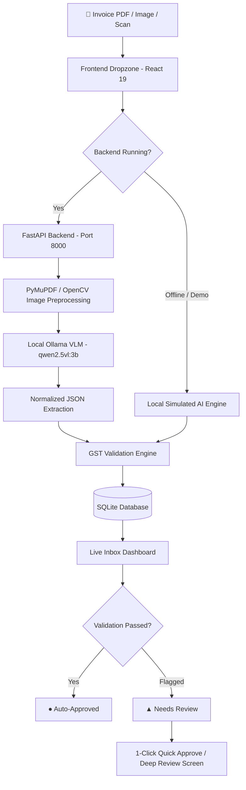

# BillBox

**Turn a pile of bills into a clean spreadsheet, privately, on your own computer.**

Small shops and freelancers lose hours every month typing bills into spreadsheets for their accountant. BillBox reads the bill photo with an open-weight vision model running on your own laptop, checks the GST math, and exports a clean file. Nothing is uploaded anywhere.

> **Try the demo:** https://billbox-pi.vercel.app/
> The hosted demo uses sample data and a simulated pipeline. No model runs there. The real app runs on your computer with Ollama (see [Run locally](#run-locally-with-the-real-model)).

[](https://ollama.com/library/qwen2.5vl)
[-success?style=flat-square)](https://ollama.com/)


---

## Who it's for

- A shop owner whose accountant keeps asking for "the bills in Excel"
- A freelancer sorting a month of receipts before tax time
- An accountant who doesn't want clients' financial documents on a cloud server

## How it works

1. Drop in photos or PDFs of bills.
2. A local vision model (`qwen2.5vl:3b` via Ollama) reads each one and returns structured data.
3. A validation engine checks the numbers and flags anything suspicious.
4. You review flagged fields next to the original image, fix them, and approve.
5. Export a CSV your accountant can open in Excel.

## Features

- **Extraction from images and PDFs:** vendor, GSTIN, invoice number, date, line items, HSN codes and taxes. The model's output is cleaned up in code (for example `04-07-2018` becomes `2018-07-04`, and `"1,031.00"` becomes the number `1031`).
- **GST and math checks:**
  - GSTIN format and checksum
  - Rate x quantity = amount, and subtotal + taxes = total
  - CGST/SGST vs IGST consistency
  - Dates in the future or older than 3 years
- **Human-in-the-loop review:** flagged invoices show what to check. Approve with one click, or open the review screen to edit fields beside the original bill.
- **Bulk approve** for batches you have already checked.
- **Dashboard:** invoice count, review backlog, approved count and total amount in INR.
- **Export:** CSV and JSON for your accountant.
- **Demo mode:** the hosted version runs on sample data so you can click through the whole flow without installing anything.

## Why open models

- **Privacy:** bills contain GSTINs, bank details and customer names. They never leave the laptop.
- **Cost:** no per-page fee, so processing 500 bills costs the same as 5.
- **Control:** the model is a one-line setting. Swap in a bigger or fine-tuned model without changing the app.

## Results

Tested on [FILL IN: number] real bills (printed invoices, phone photos, one electricity bill) on an 8 GB RAM Windows laptop with no GPU.

| Field | Correct |
|---|---|
| Vendor name | [FILL IN]/[N] |
| Invoice number | [FILL IN]/[N] |
| Date | [FILL IN]/[N] |
| Total | [FILL IN]/[N] |

Average time per bill: [FILL IN] seconds.

Validation caught [FILL IN] errors that would otherwise have gone into the spreadsheet.

## Known limitations

- A 3B model makes mistakes on digits (invoice numbers, totals), blurry photos and handwriting. That is why validation flags exist: treat the output as a draft to review, not a final record.
- It takes roughly a minute per bill on an 8 GB laptop without a GPU.
- The hosted demo does not run the model.
- The CSV is meant to be opened or imported by your accountant. It is not a ready-made import file for Tally or Zoho Books.

## Run locally with the real model

Prerequisites: [Node.js 18+](https://nodejs.org/), [Python 3.10+](https://www.python.org/), [Ollama](https://ollama.com/). Tested on Windows with 8 GB RAM.

**1. Download the model** (about 3 GB, one time):
```bash
ollama pull qwen2.5vl:3b
```
Keep Ollama running in the background. It serves the model at `http://localhost:11434`.

**2. Start the backend** (new terminal):
```bash
cd billbox
pip install -r requirements.txt
python -m uvicorn backend.main:app --reload --port 8000
```

**3. Start the frontend** (new terminal):
```bash
cd billbox/frontend
npm install
npm run dev
```

Open http://localhost:5173. When the backend is connected, the header shows **Backend Online (Port 8000)**.

---

## 🏗️ Architecture & Data Flow




## Tech stack

| Layer | Technologies |
|---|---|
| Model | `qwen2.5vl:3b` (open weights) served by Ollama |
| Frontend | React, Vite, Tailwind CSS, React Router |
| Backend | Python, FastAPI, Uvicorn, SQLModel, SQLite |
| Image processing | PyMuPDF, OpenCV, Pillow |
| Demo hosting | Vercel (frontend only) |

## Project structure

```text
billbox/
├── backend/
│   ├── api.py           # REST endpoints (upload, review, CRUD)
│   ├── config.py        # Ollama host and model settings
│   ├── db.py            # SQLite session management
│   ├── extract.py       # Ollama vision call and output normalization
│   ├── gstin.py         # GSTIN format and checksum validator
│   ├── main.py          # App entrypoint and CORS
│   ├── models.py        # Table schemas (Invoice, LineItem)
│   ├── preprocess.py    # Deskew, rotation, contrast enhancement
│   └── validate.py      # Rule engine (GST math, item math, dates)
├── frontend/
│   ├── src/
│   │   ├── components/  # KPICard, Navbar, SettingsModal, UploadArea
│   │   ├── pages/       # Review
│   │   ├── data/        # Sample invoices for demo mode
│   │   └── App.jsx      # Inbox with search, filters and approvals
│   └── vercel.json      # SPA routing for the hosted demo
└── requirements.txt
```

## License

MIT


---

## 📝 License
Distributed under the **MIT License**. Free for open-source and commercial use.
