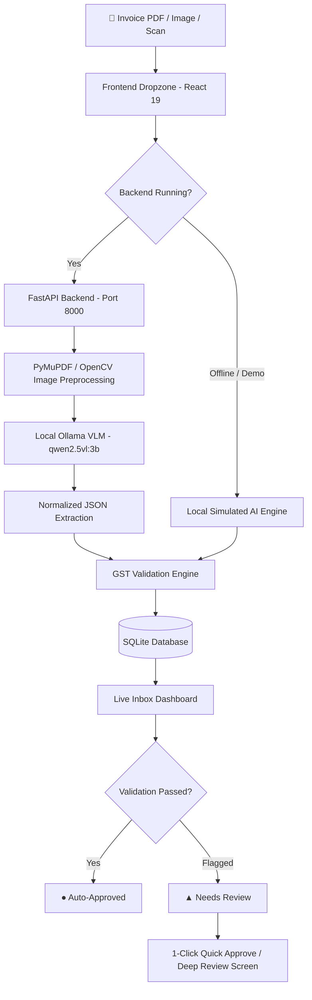

# ⚡ BillBox — AI-Powered Invoice Intake & GST Compliance Hub

[](https://billbox-pi.vercel.app/)
[](https://ollama.com/library/qwen2.5vl)
[](https://react.dev/)
[](https://fastapi.tiangolo.com/)

> **Live Production URL:** [https://billbox-pi.vercel.app/](https://billbox-pi.vercel.app/)

---

## 🏆 Hackathon Theme Alignment

> **Theme:** *"Build something with open-source AI at its core. Running an open-weight model, building on an open-source agent harness, running inference locally, or all three. The open pieces should make your project work."*

**BillBox is built strictly around 100% open-source, local AI:**
1. **Open-Weight Vision Model:** Powered by **`qwen2.5vl:3b`** (Qwen 2.5 Vision-Language Model by Alibaba, open weights).
2. **Local, Private Edge Inference:** Serviced on-device via **Ollama** (`localhost:11434`). Sensitive corporate invoices, tax identifiers, and bank details **never leave your local machine** or touch proprietary cloud APIs.
3. **Open-Source Processing Stack:** PyMuPDF, OpenCV, FastAPI, and SQLModel form an end-to-end open pipeline that parses raw image/PDF pixels into structured Indian GST tax records.

---

## 📌 Problem Statement & Solution

### The Challenge
Finance and accounting teams spend hundreds of hours manually verifying vendor invoices, typing data into ERPs, and reconciling Indian GST calculations. Cloud AI OCR solutions charge per-page fees and present serious privacy risks by uploading sensitive financial documents to external servers.

### The Solution: BillBox
**BillBox** is a modern, privacy-first invoice intake and compliance dashboard. Drop in any scanned invoice, receipt, or PDF:
* The local **Qwen2.5-VL** model visually reads the invoice layout.
* An automated **GST Validation Engine** verifies arithmetic balance, line items, and vendor GSTIN formats.
* Invoices matching compliance criteria are **automatically approved**, while anomalies are flagged for a human-in-the-loop review with **1-click quick approvals**.

---

## ✨ Key Features

* 👁️ **Visual Multimodal Extraction:** Uses open-weight VLM (`qwen2.5vl:3b`) to extract vendor details, 15-character GSTIN, invoice dates, tabular line items, HSN codes, and tax rates directly from visual coordinates.
* ⚖️ **Automated Indian GST Validation Rules:**
  * **GSTIN Verifier:** Validates 15-character state code, PAN entity, and checksum structure.
  * **Arithmetic Cross-Check:** Verifies `Rate × Quantity = Amount` and `Subtotal + CGST/SGST (or IGST) = Total`.
  * **Tax Jurisdiction:** Automatically confirms intra-state (CGST + SGST) vs inter-state (IGST) compliance.
  * **Date Sanity:** Flags invoices dated in the future or older than 3 years.
* ⚡ **1-Click Quick & Bulk Approvals:**
  * **1-Click Row Approve:** Instantly mark flagged invoices as approved without navigating away.
  * **Approve All:** Bulk-approve pending invoices with a single click.
  * **Interactive Status Chips:** Click any status chip (`● Approved` ↔ `▲ Needs Review`) to toggle status instantly.
* 📊 **Executive KPI Dashboard:** Real-time visibility into total invoice count, review backlog, approved count, and cumulative spend in INR.
* 📥 **Export to CSV / JSON:** Export clean, standardized accounting records ready for import into Tally, Zoho Books, or ERP systems.
* 🌐 **Zero-Config Offline Demo Mode:** Built with intelligent fallbacks so evaluators and judges can test the full UI, simulated OCR pipeline, and approval workflow anywhere without installing local dependencies.

---

## 🏗️ Architecture & Data Flow



---

## 🛠️ Tech Stack

| Layer | Technologies |
|---|---|
| **AI / Vision Model** | `qwen2.5vl:3b` (Open-weight Multimodal VLM) served via **Ollama** |
| **Frontend** | React 19, Vite 6, Tailwind CSS v4, React Router 7 |
| **Backend API** | Python 3.11+, FastAPI, Uvicorn, SQLModel / SQLite |
| **Computer Vision / OCR** | PyMuPDF (fitz), OpenCV (cv2), Pillow |
| **Cloud Hosting** | Vercel (Production SPA Deployment) |

---

## 🚀 Getting Started (Run Locally with Real AI)

### Prerequisites
* [Node.js 18+](https://nodejs.org/)
* [Python 3.10+](https://www.python.org/)
* [Ollama](https://ollama.com/)

---

### Step 1: Start the Local Open-Source AI Model
Pull and run the open-weight vision model in your terminal:
```bash
ollama run qwen2.5vl:3b
```
*Ollama will serve inference locally at `http://localhost:11434`.*

---

### Step 2: Start the Python Backend
In a new terminal:
```bash
cd billbox

# Install Python requirements
pip install -r requirements.txt

# Start the FastAPI server on port 8000
python -m uvicorn backend.main:app --reload --port 8000
```

---

### Step 3: Start the React Frontend
In a new terminal:
```bash
cd billbox/frontend

# Install dependencies
npm install

# Start the Vite development server
npm run dev
```

Open **`http://localhost:5173`** in your browser. The navbar status indicator will illuminate green:
👉 **`● Backend Online (Port 8000)`**

---

## 📁 Project Structure

```text
billbox/
├── backend/
│   ├── api.py           # FastAPI REST endpoints (/invoices/upload, review, CRUD)
│   ├── config.py        # Ollama host & model configuration
│   ├── db.py            # SQLite session management
│   ├── extract.py       # Ollama Vision (qwen2.5vl:3b) multimodal pipeline & normalization
│   ├── gstin.py         # Indian GSTIN regex & checksum validator
│   ├── main.py          # App entrypoint & CORS middleware
│   ├── models.py        # SQLModel table schemas (Invoice, LineItem)
│   ├── preprocess.py    # OpenCV deskewing, rotation, and CLAHE contrast enhancement
│   └── validate.py      # Business rule engine (GST calculations, item math, dates)
├── frontend/
│   ├── src/
│   │   ├── components/
│   │   │   ├── KPICard.jsx       # Metric statistics cards with hover elevation
│   │   │   ├── Navbar.jsx        # Glassmorphic header with status pills & exports
│   │   │   ├── SettingsModal.jsx # Floating settings overlay for thresholds & reviewer email
│   │   │   └── UploadArea.jsx    # Drag-and-drop AI intake zone with progress animations
│   │   ├── pages/
│   │   │   └── Review.jsx        # Deep invoice editor, flag warnings, and line-item manager
│   │   ├── data/
│   │   │   └── sampleInvoices.js # Sample benchmark test invoices
│   │   ├── App.jsx               # Main Inbox view with search, filter, and 1-click approvals
│   │   └── index.css             # Tailwind v4 entrypoint & typography
│   ├── vercel.json               # SPA client-side routing rewrites
│   └── package.json
└── requirements.txt     # Python backend dependencies
```

---

## 📝 License
Distributed under the **MIT License**. Free for open-source and commercial use.
